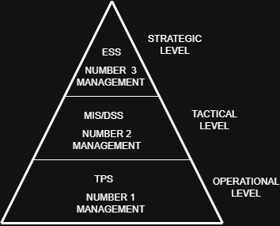

# Author: Ndivhuwo
 
 

3. Data Flow & Purpose: Explain what kind of data is processed at this level and how it supports decision-making

1.Tactical level (MIS/DSS)
.Bosses use reports from daily activities to check the progress,to manage the budgets, and they use it to solve problems and make short-term decisions.
eg this takes data from TPS to summerize it to managers it also records data daily,monthy and weeklY data

2.Strategic level
.Mostly the managers use this to shortcut information about cometitors and the economy and also business trends.
.they can also use this to plan future of the business.
eg they can compare the price with the competitors and run maybe a special or sell the product with less price to attract customers.

3.Operational level
.This handles daily activities like payments, stock records and custome orders and the information is also sent to higher management for reporting
eg if a customer buys something the time , date and the price will be recorderd

Part 2: Technical Architecture Definitions

1. IT Infrastructure Diagram: What does it show regarding physical assets?
.this shows the types the physical IT equipment used by an organisation.
.it also shows computers, servers,cables and printers.
.it also shows how they are connected with each other.
eg keyboard connected to a laptop using a usb cable 

2. IT Landscape Diagram: How does it differ by showing asset types at a logical level?
.shows the different IT systems and assets an organisation uses at a logical level.
.shows how they relate relate to each other.
.also shows application database and business applications.
eg company sales system its customer database

3. IT Architecture Diagram: What concepts, norms, and standards does it outline?
.shows the overall design and rules that guide how an organisations work together.
.it highlight policies,norms and standards that help make system secure.
.it can show how applications, data and technology are organised .
eg diagram showing all company applications must use secure connections.
